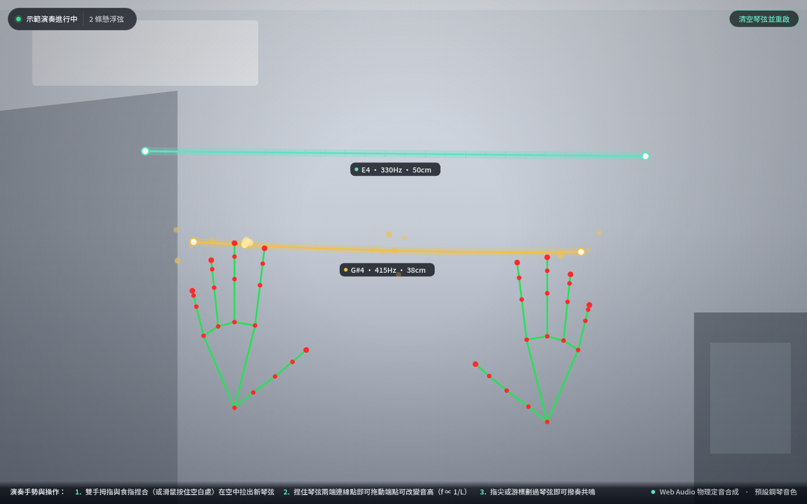

# 懸浮琴弦

用 webcam 與雙手手勢演奏的 AR 音樂遊戲原型。兩手拇指與食指捏合，在空中拉出一條懸浮弦；弦越長音越低，劃過弦身即可撥奏。再捏住端點，就能改變長度與角度。畫面與鏡頭不會離開這部裝置。

由 [open-source-hands](https://github.com/abouchedidxcode/open-source-hands) 的官方遊戲 starter 改寫，雙手追蹤使用 MediaPipe Hand Landmarker（`numHands: 2`）。

- 程式庫：[github.com/wayneleong-byte/ar-hand-strings](https://github.com/wayneleong-byte/ar-hand-strings)
- 線上試玩（HTTPS，可開鏡頭）：[wayneleong-byte.github.io/ar-hand-strings](https://wayneleong-byte.github.io/ar-hand-strings/)



```bash
git clone https://github.com/wayneleong-byte/ar-hand-strings.git
cd ar-hand-strings
npm install
npm run dev          # http://localhost:5173  鏡頭需要 localhost 或 https
```

瀏覽器會要求你點一下以開啟鏡頭與聲音。若鏡頭被擋，仍可用滑鼠或觸控演奏。

## 怎麼玩

| 動作 | 雙手（鏡頭） | 滑鼠 / 觸控 | 鍵盤 |
| --- | --- | --- | --- |
| 拉出新弦 | 兩手同時捏合（拇指＋食指），拉開後鬆手，弦留在畫面中 | 按住空白處拖到另一端再放開；觸控螢幕可用兩指同時按住 | |
| 改變長度／角度 | 捏住靠近端點的珍珠並拖動 | 按住端點拖動 | |
| 撥弦發聲 | 指尖劃過弦身，或在弦身上捏一下再放開 | 游標劃過弦身 | |
| 清空 | 右上「清空琴弦並重啟」 | 同一按鈕 | Esc |
| 靜音 | | | M |

音高以弦長反比頻率（f ∝ 1/L）計算，並校準到「49 cm 為 E4／330 Hz」，再就近對到十二平均律，所以標籤會顯示音名、頻率與長度（例如 `E4 · 330Hz · 49cm`）。聲音是 Web Audio 的物理定音合成，預設鋼琴音色。

## 指令

```bash
npm run dev          # 開發伺服器（首次會複製 MediaPipe wasm 並下載手部模型）
npm test             # vitest：音高、拉弦、撥弦、雙手 pinch 辨識，不需要瀏覽器
npm run build        # 型別檢查後建出 dist/（相對路徑，可放在任何資料夾）
npm run capture      # 需先開 dev server：bot 與滑鼠後備的截圖，寫入 captures/
npm run capture -- mobile
npm run fps          # DPR 2 下 bot 演奏的幀率（目標 60，p95 低於 16.8 ms）
npm run loud         # bot 演奏時的響度（目標 p90 −27 到 −31 dBFS，峰值低於 −8）
```

Playwright 第一次需要瀏覽器：`npx playwright install chromium`。

## 網址參數與測試鉤子

| 參數 | 作用 |
| --- | --- |
| `?bot=1` | 一對合成手透過真實手勢引擎自動拉弦、撥弦、調弦 |
| `?autostart=1` | 跳過標題，進入滑鼠模式 |
| `?mute=1` | 無聲 |

`window.__game` 回傳 `{ phase, mode, strings, stringCount, plucks, lastPluck, notes, hands, fps, dpr }`。`window.__app` 提供 `{ clear, begin, createString(x1,y1,x2,y2), pluck(id) }`，供 Playwright 在沒有鏡頭時驅動。

## 檔案

| 檔案 | 負責 |
| --- | --- |
| `src/main.ts` | 接線：輸入 → 手勢 → 畫面與聲音、標題、HUD、旗標、測試鉤子 |
| `src/rules.ts` | 琴弦規則（無 DOM）：建弦、拖端點、撥弦、粒子。可單測 |
| `src/string-gestures.ts` | 雙手語彙：雙 pinch 拉弦、抓端點、劃弦撥奏；單指標拖曳後備 |
| `src/pitch.ts` | 弦長 ↔ 頻率（f ∝ 1/L）與音名 |
| `src/input.ts` | 鏡頭（雙手）、滑鼠／觸控、bot 都變成同一種手（pinch 點＋強度） |
| `src/pinch.ts` | pinch 強度 → 按下／放開（遲滯），依手 id 各一組 |
| `src/bot.ts` | `?bot=1` 使用的合成雙手順本 |
| `src/scene.ts` | 2D AR 疊加：鏡像鏡頭、綠骨紅點骨骼、彩色弦、標籤、粒子 |
| `src/audio.ts` | Web Audio 鋼琴音色（錘擊噪音＋帶少許非諧和的分音） |
| `src/hand-gesture-kit/` | 套件本體，由上游 `src/kit` 原樣複製。請設定、不要改它 |
| `scripts/assets.mjs` | 把 MediaPipe wasm 與手部模型放到 `public/` |
| `tools/` | `capture.mjs`、`fps.mjs`、`loud.mjs` |
| `tests/` | 規則、雙手 pinch、拉弦與撥弦 |

## 手勢怎麼接上，以及可調常數

套件以 MediaPipe Hand Landmarker 追蹤最多兩隻手，並已做 One Euro 平滑。每一幀提供 `hand.pinch`（0..1）。`src/pinch.ts` 在 `PINCH_ON`（0.6）按下、在 `PINCH_OFF`（0.35）放開。不要再疊一層平滑。

拉弦、抓端點、撥弦不是套件的現成事件（套件的雙手事件是拍手、縮放、轉向），而是在 `src/string-gestures.ts` 用兩手的 landmarks 與 pinch 距離自行定義：

- 兩手都 pinch、且都沒抓到端點：在兩 pinch 點之間拉出草稿弦；任一手放開且夠長，弦就留在畫面中。
- pinch 點靠近端點（`GRAB_R`）：拖動該端點。
- pinch 在弦身上再放開，或指尖軌跡穿過弦身（`PLUCK_R`）：撥弦並發聲。

鏡頭模式下，骨骼與 pinch 點會經過與畫面相同的 object-fit: cover 對應，對齊鏡像後的實況畫面。請用 `toScreen`／此對應，不要再把 landmarks 鏡像一次。

校準：畫面寬視為 `VIEW_WIDTH_CM`（80 cm），49 cm 對應 E4 330 Hz。

## 注意

- 鏡頭必須在使用者點擊後啟動，且頁面位於 https 或 localhost。
- 此原型尚未發佈到公開網站。
